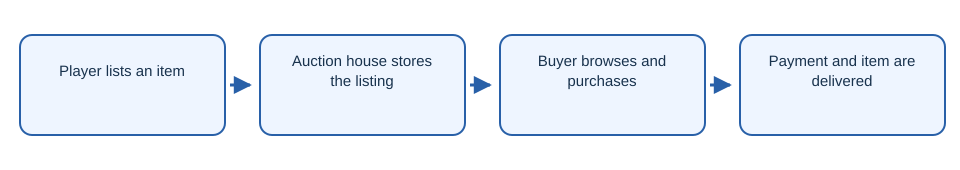

# NeonAuction

Minecraft auction house plugin with listings, purchases, and SQLite storage.

## Workflow

1. Player lists an item.
2. Auction house stores the listing.
3. Buyer browses and purchases.
4. Payment and item are delivered.

## Getting started

Build with `./gradlew build` and install the JAR on a compatible Paper server.

## License

Licensed under [AGPL-3.0](LICENSE).
